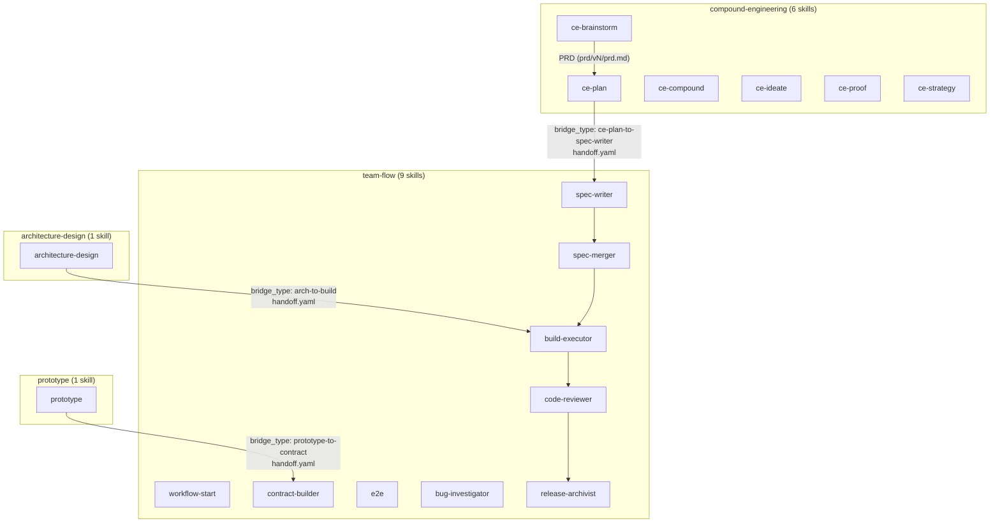
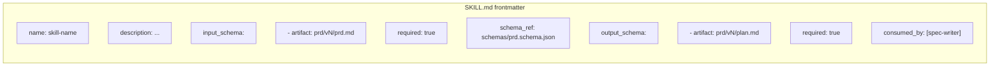
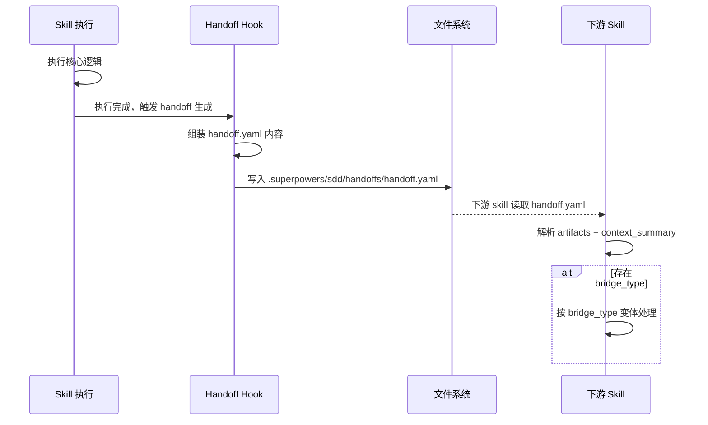

# Skill 协作协议层设计 - 实施方案

> 关联 PRD：[prd/v1/prd.md](prd/v1/prd.md)
> 模式：一人公司模式
> 版本：v1
> 创建日期：2026-07-20

---

## Goal Capsule

- **目标**：为 team-flow 的 17 个 skill 建立统一协作协议层，以 Schema 声明式协议 + Handoff 模板的混合机制替代当前的隐式约定。
- **权威来源**：PRD `prd/v1/prd.md`
- **停止条件**：三阶段（PRD 对齐、Schema 协议层、Handoff + DP 优化）均完成且通过验收
- **执行方向**：smoke-first 验证 — 配置/协议层工作以可运行验证为先

---

## Product Contract

### Summary

team-flow 插件包含 17 个 skill，覆盖四套子系统（team-flow 9 个、compound-engineering 6 个、architecture-design 1 个、prototype 1 个），已拼合到 `plugin.json`。当前 skill 之间的协作依赖隐式约定，缺少统一协作协议。本计划实施 Schema 声明式协议 + Handoff 模板的混合协作机制。

### Problem Frame

- 四套子系统的 skill 间数据流转依赖隐式约定，缺少机器可解析的工件契约
- ce-plan 到 spec-writer、architecture-design 到 build-executor、prototype 到 contract-builder 三个核心衔接点缺少显式 handoff
- DP（决策点）信息展示依赖人工整理，无自动化摘要提取

### Requirements

**Phase 1 — PRD 对齐**

- R1. ce-brainstorm 读取 `prd.template` 配置字段指定 PRD 模板路径，未配置时使用默认模板 `templates/prd.md`
- R2. ce-brainstorm 产出 PRD 写入 `prd/vN/prd.md`，替代 `docs/plans/` 路径
- R3. ce-brainstorm 启动时扫描 `prd/` 目录检测已有迭代版本，自动建议新版本
- R4. PRD 元数据适配：移除 `artifact_contract`/`artifact_readiness`/`product_contract_source`，新增 `project_name`/`iteration_version`/`prd_template`
- R5. PRD 章节结构对齐：从 Goal Capsule + Product Contract 改为 PRD 模板 11 章结构（§1-§8 对话填充，§5/§9-§11 占位保留）

**Phase 2 — Schema 协议层**

- R6. 每个 SKILL.md 的 frontmatter 增加 `input_schema` 字段，声明消费的工件列表（`artifact`、`required`、`schema_ref`）
- R7. 每个 SKILL.md 的 frontmatter 增加 `output_schema` 字段，声明产出工件及下游消费者（`consumed_by`）
- R8. 在 `schemas/` 目录下维护关键衔接点的 JSON Schema 定义文件

**Phase 3 — Handoff + DP 优化**

- R9. 每个 skill 执行完成时生成标准 `handoff.yaml`（字段：`from_skill`、`to_skill`、`timestamp`、`artifacts`、`context_summary`、`dp_digest`）
- R10. 四套子系统衔接点使用专用 handoff 变体，通过 `bridge_type` 字段区分
- R11. 每个 DP 触发 skill 从上游 handoff 自动提取结构化摘要，生成精炼的 DP 展示信息

### Scope Boundaries

**包含**

- Schema 声明式协议（input_schema / output_schema frontmatter 扩展）
- Handoff 模板机制（handoff.yaml 生成与消费）
- DP 信息展示优化
- PRD 模板可配置与输出路径标准化
- 三个核心衔接点的 bridge_type 机制

**Deferred to Follow-Up Work**

- Schema 运行时自动校验（当前仅声明，不强制校验）
- 非四套子系统衔接点的 bridge_type 扩展
- Skill 运行时按 schema 自动发现与加载
- 自动化 bridge_type 检测（当前手动指定）

**不包含（Outside scope）**

- 新增 skill 或修改 skill 核心逻辑
- 修改 8 态状态机定义
- GUI 交互层面的改造

### Acceptance Examples

- AE1. ce-brainstorm 通过 `config.local.yaml` 的 `prd.template` 字段读取自定义 PRD 模板，未配置时回退到 `templates/prd.md`
- AE2. 执行 `ls prd/` 后 ce-brainstorm 能自动识别 `v1` 存在并建议创建 `v2`
- AE3. 任意 skill 的 SKILL.md frontmatter 中包含合法的 `input_schema` 和 `output_schema` 声明
- AE4. skill 执行完成后在 `.superpowers/sdd/handoffs/` 目录下生成 `handoff.yaml`，包含全部 6 个必要字段
- AE5. `ce-plan → spec-writer` 衔接点的 handoff.yaml 包含 `bridge_type: ce-plan-to-spec-writer`

---

## Planning Contract

### Key Technical Decisions

- **KTD-1: YAML frontmatter 扩展声明 schema** — 在 SKILL.md 的 YAML frontmatter 中直接声明 `input_schema`/`output_schema`，而非使用独立配置文件。理由：与现有 frontmatter 惯例一致（`name`、`description`、`argument-hint`），保持 skill 定义的自包含性。
- **KTD-2: JSON Schema 定义集中存放** — 关键衔接点的 JSON Schema 定义文件存放在 `schemas/` 目录下，而非散落在各 skill 目录中。理由：衔接点涉及跨子系统，集中管理便于发现和维护。
- **KTD-3: handoff.yaml 存放于 `.superpowers/sdd/handoffs/`** — 继承现有 `.superpowers/sdd/` 目录约定，handoff 文件与 skill 执行上下文共存。
- **KTD-4: PRD 版本策略为 vN 递增** — 使用 `v1`、`v2` 等简单递增版本号，基于 `prd/` 目录扫描结果自动建议。理由：与 PRD 的迭代概念天然对齐，无额外格式约束。
- **KTD-5: bridge_type 手动标注** — 四套子系统的 3 个核心衔接点的 bridge_type 由上游 skill 显式声明，而非自动检测。理由：简化首期实现，避免复杂的 skill 依赖分析。

### High-Level Technical Design

#### 四套子系统协作架构

#### Schema 声明协议结构

#### Handoff 生命周期

### Assumptions

- 现有 SKILL.md 的 frontmatter 格式为标准 YAML，可直接扩展新字段
- `tf runtime config` 命令可读取 `prd.template` 配置字段（已在 team-flow 中实现）
- `.superpowers/sdd/handoffs/` 目录结构已存在或可安全创建
- PRD 模板的 11 章结构在后续迭代中不会大幅调整

---

## Implementation Units

### U1. PRD 模板可配置

- **Goal**：让 ce-brainstorm 支持通过 `prd.template` 配置字段指定自定义 PRD 模板路径
- **Requirements**：R1
- **Dependencies**：无
- **Files**：
  - `skills/ce-brainstorm/SKILL.md`（修改模板读取逻辑说明）
  - `templates/prd.md`（确认默认模板存在）
- **Approach**：在 ce-brainstorm 的 SKILL.md 中增加模板加载逻辑描述：启动时读取 `config.local.yaml` 的 `prd.template` 字段，有值则使用指定模板路径，无值则回退到 `templates/prd.md`
- **Patterns to follow**：现有 SKILL.md 的配置读取模式
- **Test scenarios**：
  - 配置了 `prd.template: templates/custom-prd.md` 时，ce-brainstorm 使用该模板
  - 未配置 `prd.template` 时，ce-brainstorm 使用 `templates/prd.md`
  - 配置了不存在的模板路径时，输出明确错误并回退到默认模板
- **Verification**：修改后的 SKILL.md 包含明确的模板加载逻辑描述；`templates/prd.md` 文件存在且格式正确

### U2. 迭代版本检测与 PRD 输出路径标准化

- **Goal**：让 ce-brainstorm 自动扫描 `prd/` 目录检测迭代版本，PRD 产出写入 `prd/vN/prd.md`
- **Requirements**：R2, R3
- **Dependencies**：无
- **Files**：
  - `skills/ce-brainstorm/SKILL.md`（增加版本检测和输出路径逻辑）
- **Approach**：在 ce-brainstorm SKILL.md 中增加：(1) 启动时扫描 `prd/` 目录列出已有 `vN` 子目录；(2) 建议下一个版本号（已有 v1 则建议 v2）；(3) 输出路径固定为 `prd/vN/prd.md`，不再写入 `docs/plans/`
- **Patterns to follow**：ce-plan SKILL.md 中 Phase 0.2 的 PRD 扫描逻辑
- **Test scenarios**：
  - `prd/` 目录为空时，建议 v1 并写入 `prd/v1/prd.md`
  - `prd/v1/` 已存在时，建议 v2 并写入 `prd/v2/prd.md`
  - `prd/v1/` 和 `prd/v2/` 已存在时，建议 v3
- **Verification**：SKILL.md 包含目录扫描逻辑和输出路径规范；不再引用 `docs/plans/` 作为 PRD 输出路径

### U3. PRD 元数据与章节结构对齐

- **Goal**：将 ce-brainstorm 的产出格式从 Goal Capsule + Product Contract 对齐为 PRD 模板的 11 章结构
- **Requirements**：R4, R5
- **Dependencies**：U1, U2
- **Files**：
  - `skills/ce-brainstorm/SKILL.md`（修改产出格式和元数据定义）
  - `templates/prd.md`（确认 11 章模板结构）
- **Approach**：(1) 移除 `artifact_contract`/`artifact_readiness`/`product_contract_source` 元数据字段；(2) 新增 `project_name`/`iteration_version`/`prd_template` 元数据字段；(3) 产出章节映射：对话信息 -> PRD 11 章结构（§1 元数据自动填充，§2-§4/§6-§8 对话填充，§5/§9-§11 占位保留）
- **Patterns to follow**：现有 `templates/prd.md` 的 11 章结构
- **Test scenarios**：
  - 产出的 PRD 文件包含 §1 版本修订记录（自动填充项目信息）
  - §2-§4（业务流程、流程图、画面原型）由对话内容填充
  - §6-§8（术语字典、功能清单、处理说明书）由对话内容填充
  - §5（报表清单）、§9-§11（自查报告、完成报告、评审纪要）保留模板占位符
  - 元数据不包含已废弃的 `artifact_contract` 等字段
- **Verification**：ce-brainstorm 产出的 PRD 文件与 `templates/prd.md` 的 11 章结构一致；元数据字段正确替换

### U4. Schema 声明机制

- **Goal**：为 17 个 skill 的 SKILL.md frontmatter 增加 `input_schema` 和 `output_schema` 声明
- **Requirements**：R6, R7
- **Dependencies**：无
- **Files**：
  - `skills/ce-brainstorm/SKILL.md`（示例 skill，首个修改）
  - `skills/ce-plan/SKILL.md`
  - `skills/spec-writer/SKILL.md`
  - `skills/build-executor/SKILL.md`
  - `skills/code-reviewer/SKILL.md`
  - `skills/spec-merger/SKILL.md`
  - `skills/workflow-start/SKILL.md`
  - `skills/contract-builder/SKILL.md`
  - `skills/bug-investigator/SKILL.md`
  - `skills/release-archivist/SKILL.md`
  - `skills/ce-compound/SKILL.md`
  - `skills/ce-ideate/SKILL.md`
  - `skills/ce-proof/SKILL.md`
  - `skills/ce-strategy/SKILL.md`
  - `skills/architecture-design/SKILL.md`
  - `skills/prototype/SKILL.md`
  - `skills/e2e/SKILL.md`
  - `schemas/`（新建目录）
- **Approach**：(1) 为每个 skill 设计其 `input_schema`（消费的工件列表）和 `output_schema`（产出工件及 `consumed_by`）；(2) 在 frontmatter 中以 YAML 列表格式声明；(3) 创建 `schemas/` 目录存放 JSON Schema 定义
- **Execution note**：先完成一个代表性 skill（如 ce-brainstorm）的完整 schema 声明作为模板，再批量扩展到其余 16 个 skill
- **Test scenarios**：
  - ce-brainstorm 的 frontmatter 包含 `input_schema`（无必需输入，来源于用户对话）和 `output_schema`（产出 `prd/vN/prd.md`，consumed_by: `[ce-plan]`）
  - ce-plan 的 frontmatter 包含 `input_schema`（消费 `prd/vN/prd.md`）和 `output_schema`（产出 `prd/vN/plan.md`，consumed_by: `[spec-writer]`）
  - spec-writer 的 `input_schema` 引用 `schemas/plan.schema.json`
  - 所有 17 个 skill 的 schema 声明语法正确、无遗漏必填字段
  - `input_schema` 中 `required: false` 的工件不阻塞 skill 执行
- **Verification**：所有 17 个 SKILL.md 的 frontmatter 包含合法的 `input_schema`/`output_schema`；`schemas/` 目录存在且包含关键 JSON Schema 文件

### U5. JSON Schema 定义与衔接点映射

- **Goal**：为关键衔接点建立 JSON Schema 定义文件，建立工件的机器可解析契约
- **Requirements**：R8
- **Dependencies**：U4
- **Files**：
  - `schemas/prd.schema.json`（PRD 工件 schema）
  - `schemas/plan.schema.json`（实施方案 schema）
  - `schemas/handoff.schema.json`（handoff.yaml schema）
  - `schemas/design.schema.json`（架构设计 schema）
  - `schemas/prototype.schema.json`（原型 schema）
- **Approach**：(1) 从三个核心衔接点的需求出发定义 schema：`prd/vN/prd.md`（ce-brainstorm → ce-plan）、`prd/vN/plan.md`（ce-plan → spec-writer）、`design.md`（architecture-design → build-executor）；(2) handoff.schema.json 定义 handoff.yaml 的完整结构；(3) schema 文件集中存放在 `schemas/` 目录
- **Test scenarios**：
  - `prd.schema.json` 验证包含 11 章结构的 PRD 文件
  - `plan.schema.json` 验证包含 frontmatter（title, type, date）和核心章节的实施方案
  - `handoff.schema.json` 验证包含 6 个必要字段（from_skill, to_skill, timestamp, artifacts, context_summary, dp_digest）的 handoff.yaml
  - 各 schema 文件自身是合法的 JSON Schema（draft-07 或更高版本）
- **Verification**：`schemas/` 目录下每个 `.json` 文件可被 JSON Schema 验证器解析；schema 定义与实际工件结构匹配

### U6. Handoff 文件生成机制

- **Goal**：建立 skill 执行完成时的标准 handoff.yaml 生成机制
- **Requirements**：R9, R10
- **Dependencies**：U5
- **Files**：
  - `skills/ce-brainstorm/SKILL.md`（增加 handoff 生成逻辑）
  - `skills/ce-plan/SKILL.md`
  - `skills/spec-writer/SKILL.md`
  - `skills/build-executor/SKILL.md`
  - `skills/code-reviewer/SKILL.md`
  - `skills/spec-merger/SKILL.md`
  - `skills/workflow-start/SKILL.md`
  - `skills/contract-builder/SKILL.md`
  - `skills/bug-investigator/SKILL.md`
  - `skills/release-archivist/SKILL.md`
  - `skills/ce-compound/SKILL.md`
  - `skills/ce-ideate/SKILL.md`
  - `skills/ce-proof/SKILL.md`
  - `skills/ce-strategy/SKILL.md`
  - `skills/architecture-design/SKILL.md`
  - `skills/prototype/SKILL.md`
  - `skills/e2e/SKILL.md`
- **Approach**：(1) 在每个 SKILL.md 中增加"Handoff 生成"段落，描述执行完成时组装 handoff.yaml 的逻辑；(2) handoff.yaml 包含 6 个必要字段：`from_skill`、`to_skill`、`timestamp`、`artifacts`、`context_summary`、`dp_digest`；(3) 三个核心衔接点额外包含 `bridge_type` 字段
- **Execution note**：先完成一个 skill（如 ce-brainstorm）的 handoff 生成逻辑作为范例，再扩展到其余 skill。重点关注三个桥接点（ce-plan、architecture-design、prototype）的 bridge_type 变体
- **Test scenarios**：
  - ce-brainstorm 执行完成后生成 handoff.yaml，包含 `from_skill: ce-brainstorm`、`to_skill: ce-plan`、有效的 `timestamp`、`artifacts` 引用 `prd/vN/prd.md`
  - ce-plan 执行完成后生成 handoff.yaml，包含 `bridge_type: ce-plan-to-spec-writer`
  - architecture-design 执行完成后生成 handoff.yaml，包含 `bridge_type: arch-to-build`
  - prototype 执行完成后生成 handoff.yaml，包含 `bridge_type: prototype-to-contract`
  - handoff 生成失败时不阻塞 skill 正常执行（graceful degradation）
  - `dp_digest` 字段在包含决策点摘要的 skill 中有值，其他 skill 为空
- **Verification**：每个 SKILL.md 包含明确的 handoff 生成逻辑描述；三个桥接点的 bridge_type 值与 PRD §3.1.2.3 一致

### U7. DP 信息展示优化

- **Goal**：让每个 DP 触发 skill 从上游 handoff 自动提取结构化摘要
- **Requirements**：R11
- **Dependencies**：U6
- **Files**：
  - `skills/workflow-start/SKILL.md`（DP-0 触发点）
  - `skills/ce-brainstorm/SKILL.md`（DP-1 触发点）
  - `skills/ce-plan/SKILL.md`（DP-2 触发点）
  - `skills/spec-writer/SKILL.md`（DP-3 触发点）
  - `skills/architecture-design/SKILL.md`（DP-4 触发点）
  - `skills/build-executor/SKILL.md`（DP-5 触发点）
  - `skills/code-reviewer/SKILL.md`（DP-6 触发点）
  - `skills/spec-merger/SKILL.md`（DP-7 触发点）
- **Approach**：(1) 定义 DP 展示模板：从 handoff.yaml 的 `context_summary` 和 `dp_digest` 字段提取精炼信息；(2) 在每个 DP 触发 skill 的 SKILL.md 中增加 DP 信息提取逻辑；(3) DP-0 到 DP-7 共 8 个决策点，每个有独立的展示模板
- **Test scenarios**：
  - DP-0（workflow-start）从上游 handoff 提取项目初始化摘要
  - DP-2（ce-plan）从 handoff 提取实施方案的关键决策摘要
  - DP-5（build-executor）从 handoff 提取架构设计约束摘要
  - `dp_digest` 为空时，DP 展示回退到 `context_summary` 的完整内容
  - 无上游 handoff 时，DP 展示提示"无上游交接信息"
- **Verification**：每个 DP 触发 skill 的 SKILL.md 包含 DP 信息提取逻辑；8 个决策点均有对应的展示模板

---

## 风险与约束

| 风险项 | 影响 | 应对策略 |
|---|---|---|
| 现有 SKILL.md frontmatter 格式不兼容新字段 | 所有 17 个 skill 需重新验证 | 先在一个 skill 上验证 YAML 解析兼容性，再批量扩展 |
| handoff 生成失败可能影响 skill 执行流畅性 | skill 执行被阻塞 | handoff 生成设计为 graceful degradation，失败不阻塞 skill |
| PRD 模板路径变更可能影响已有 ce-brainstorm 流程 | 用户使用旧路径时找不到 PRD | 保留默认模板 `templates/prd.md` 作为回退 |
| 17 个 skill 的 schema 声明工作量较大 | 实施周期延长 | 使用 U4 的"先模板后批量"策略，降低重复工作量 |
| bridge_type 值硬编码在 skill 中 | 后续新增衔接点需修改 skill | 首期手动标注可接受，Deferred 中已记录自动化检测作为后续优化 |

---

## 技术方案（一人公司模式专用）

### 5.1 技术选型

| 技术领域 | 选型 | 选型理由 | 备选方案 |
|---|---|---|---|
| Schema 声明格式 | YAML frontmatter 扩展 | 与现有 SKILL.md 惯例一致，自包含 | 独立 schema 配置文件 |
| JSON Schema 版本 | JSON Schema draft-07 | 广泛兼容、工具链成熟 | draft-2020-12 |
| Handoff 文件格式 | YAML | 人类可读、易于手写和解析 | JSON、TOML |
| 配置管理 | config.local.yaml | 继承 team-flow 现有配置机制 | 环境变量、独立配置文件 |

### 5.2 架构设计概要

架构分为三层：

1. **声明层（Schema Protocol）** — 每个 skill 的 SKILL.md frontmatter 包含 `input_schema`/`output_schema` 声明，定义工件契约。集中存放在 `schemas/` 目录的 JSON Schema 文件提供机器可解析的校验依据。

2. **传递层（Handoff Mechanism）** — skill 执行完成时生成 `handoff.yaml`，存放在 `.superpowers/sdd/handoffs/`。包含 6 个必要字段 + 可选 `bridge_type`。三个核心衔接点（ce-plan -> spec-writer、architecture-design -> build-executor、prototype -> contract-builder）使用 bridge_type 变体。

3. **展示层（DP Display）** — DP 触发 skill 从 handoff.yaml 的 `context_summary` 和 `dp_digest` 提取精炼摘要，生成决策点展示信息。

数据流：skill 执行 -> 产出工件 + handoff.yaml -> 下游 skill 读取 handoff -> 按 schema 声明验证输入 -> DP 触发时提取摘要展示

### 5.3 数据模型变更

本次迭代不涉及持久化数据模型变更。核心"数据"为三种文件：

- **SKILL.md frontmatter** — 增加 `input_schema`/`output_schema` YAML 字段
- **handoff.yaml** — 新增文件类型，结构化交接信息
- **JSON Schema 文件** — `schemas/` 目录下的 `.json` 定义文件

### 5.4 API 设计概要

不涉及 HTTP API。"接口"为 skill 间的文件级协议：

| 接口 | 格式 | 位置 | 消费者 |
|---|---|---|---|
| SKILL.md frontmatter | YAML | `skills/<name>/SKILL.md` | skill 加载器、schema 验证器 |
| handoff.yaml | YAML | `.superpowers/sdd/handoffs/` | 下游 skill |
| JSON Schema 定义 | JSON | `schemas/*.json` | schema 验证器 |

### 5.5 关键技术决策

| 决策项 | 决策内容 | 理由 | 备选方案 |
|---|---|---|---|
| Schema 声明位置 | SKILL.md frontmatter 内联 | 自包含、与现有惯例一致 | 独立 schema 配置文件 |
| Handoff 存储 | `.superpowers/sdd/handoffs/` | 继承现有目录约定 | 项目根目录、skill 输出目录 |
| bridge_type 策略 | 手动标注 | 简化首期实现 | 自动检测 |
| PRD 模板回退 | 默认 `templates/prd.md` | 兼容无配置场景 | 必须配置 |
| JSON Schema 版本 | draft-07 | 工具链兼容性 | draft-2020-12 |

---

## 里程碑计划

| 里程碑 | 包含任务 | 目标日期 | 交付物 |
|---|---|---|---|
| M1 - PRD 对齐 | U1, U2, U3 | 2026-07-22 | 改造后的 ce-brainstorm SKILL.md + 验证 PRD 产出 |
| M2 - Schema 协议层 | U4, U5 | 2026-07-25 | 17 个 skill 的 schema 声明 + schemas/ 目录 |
| M3 - Handoff + DP 优化 | U6, U7 | 2026-07-28 | 17 个 skill 的 handoff 逻辑 + 8 个 DP 展示模板 |

---

## 待定事项

- [ ] 确认 `tf runtime config --get prd.template` 是否已在 team-flow 中实现
- [ ] 确认 `.superpowers/sdd/handoffs/` 目录是否已在现有框架中创建
- [ ] 确认 17 个 skill 的完整列表是否与本文档一致（需对照 `plugin.json` 校验）
- [ ] DP-0 到 DP-7 的完整映射关系（哪个 skill 对应哪个 DP）需与实际状态机对照确认
