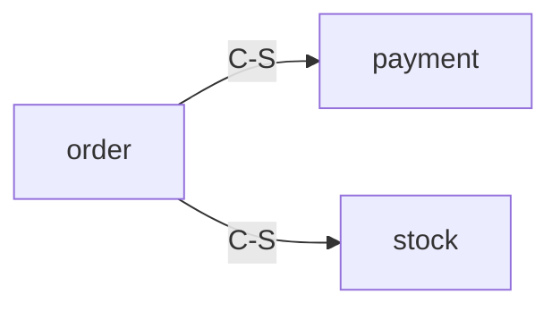

# S3.5 产品级架构文档模板（v0.35.0，v0.14 §60）

> 产品级架构设计（architecture 阶段）产出的权威文档模板。基于 4A + DDD 方法论，覆盖 6 类产物。
> 位置：`docs/architecture/iterations/vN/architecture.md`（预测态快照，P1：不写全局当前态）。
> 产出后须经产品级评审门（architecture-reviewer product 视角）PASS 才进 S4。

## 文档骨架

````markdown
---
iteration_version: v1              # 迭代版本号
provenance: forward-designed       # forward-designed | reverse-engineered | mixed
established_at: <ISO 8601>         # 快照冻结时间
snapshot_status: in-flight         # in-flight | superseded | archived
superseded_by: null                # 下一版快照路径（退役时填）
---
# 产品级架构设计 · 迭代 vN

## 1 限界上下文（Context Map）          <a id="bc"></a>

| 上下文 | 职责(一句话) | 依赖 | 关系类型 | 语言边界/关键术语 |
|--------|------------|------|---------|-----------------|
| order  | 订单生命周期与履约 | payment, stock | Customer-Supplier | 客户=下单人 |
| payment| 收款与对账 | order | Open Host Service | 客户=付款人（同词异义） |

> mermaid：上下文关系图


**关系类型枚举（6 种）**：Shared Kernel / Customer-Supplier / Conformist / Anti-Corruption Layer / Open Host Service / Separate Ways。

## 2 聚合注册表                        <a id="aggregates"></a>

| 聚合ID | 上下文 | 根实体 | 值对象 | 核心行为 | 关键不变量 | 事务边界 | 状态机锚点 |
|--------|--------|--------|--------|---------|-----------|---------|-----------|
| order:Order | order | Order | OrderItem, Address, OrderStatus | PlaceOrder/MarkPaid/Ship/Complete | 总金额=明细和；状态流转有序 | 订单事务 | §4.1 |

### 2.2 聚合→表映射
| 聚合 | 表集合 | 读模型 |
|------|--------|--------|
| order:Order | t_order, t_order_item, t_order_status_history | v_order_summary |

### 2.3 聚合大小自检
- [ ] 每聚合实体数 ≤5（超过提示拆分）
- [ ] 事务边界无合并迹象
- [ ] 并发写冲突高发区已识别

> **唯一事实源**：本注册表是 BC 边界/聚合所有权的产品级权威；变更级（change 内）只引用本表 id，不重定义。

## 3 指令与事件识别                  <a id="commands-events"></a>

### 3.1 指令表
| 指令 | 触发方 | 目标聚合 | Command/Read/Query | 结果事件 |
|------|--------|---------|-------------------|---------|
| PlaceOrder | Client | order:Order | Command | OrderPlaced |
| MarkPaid | PaymentCaptured 集成 | order:Order | Command | OrderPaid |

### 3.2 事件表
| 事件 | 类型(领域/集成/外部) | 源聚合/上下文 | 触发 | 携带数据 | 消费方 | 投影读模型 |
|------|--------------------|--------------|------|---------|--------|-----------|
| OrderPlaced | 领域 | order:Order | PlaceOrder | orderId, items | payment, stock | order-summary-view |
| PaymentCaptured | 集成 | payment:Payment | 支付回调 | orderId, paymentId | order:Order | order-summary-view |

### 3.3 事件流图
> mermaid：事件→指令级联链（覆盖 saga/process manager 跨聚合长流程一致性）

### 3.4 读模型投影清单
| 读模型 | 投影来源事件 | 更新方式(同步/异步) |
|--------|-------------|-------------------|
| order-summary-view | OrderPlaced, PaymentCaptured | 异步 |

> 显式声明：事件用于**变更通知与投影驱动，不引入事件溯源持久化**。事件命名规范 `OrderPlaced`（名词+过去式动词），全系统一致。

## 4 聚合状态迁移                  <a id="state-machines"></a>

### 4.1 {order:Order} 状态机
> mermaid stateDiagram-v2

### 4.2 状态表
| 状态 | 触发(Command/Event) | 触发源上下文 | 目标状态 | guard 不变量 |
|------|--------------------|------------|---------|-------------|
| 创建 | PlaceOrder | order | 已支付 | 总金额>0 |
| 已支付 | Ship | order | 已发货 | 已收款 |

> 区分**聚合状态机**（本表，聚合事务边界内）与**跨聚合流程状态机**（入 saga，不在聚合状态机内表达）。

## 5 数据模型 / ER（概念级）         <a id="erd"></a>

### 5.1 聚合边界 ER
> mermaid erDiagram：同聚合表圈在一起标注聚合根表；跨聚合外键标"引用关系（非事务内）"。

### 5.2 实体表
| 实体 | 关键字段 | 所属聚合 | 写/读模型 |
|------|---------|---------|----------|
| Order | id, status, total | order:Order | 写 |

> **派生纪律**：ER 从聚合注册表 + 状态图映射而来，**禁止先画 ER 再定聚合**（DB 表 ≠ 聚合）。

## 6 应用时序（关键用例）           <a id="sequences"></a>

### 6.1 用例索引
| 用例 | 图文件 | 涉及聚合/上下文 |
|------|--------|---------------|
| 下单履约 | diagrams/sequences/order-place.md | order, payment, stock |

### 6.2 {用例} 时序图
> mermaid sequenceDiagram：跨聚合/跨上下文关键流程 Top-N。

## 7 跨域一致性检查                <a id="consistency"></a>

### 7.1 AA ↔ IA 双对齐（F2 门禁）
| AA 功能 | IA 实体 | 对齐状态 | 说明 |
|---------|---------|---------|------|
| PlaceOrder | Order | ✅ | |

- [ ] 每个 AA 功能 ≥1 个 IA 实体支撑
- [ ] 每个 IA 实体 ≥1 个 AA 功能消费（无孤立节点）

### 7.2 语义一致性
| 概念 | 上下文 A 命名 | 上下文 B 命名 | 一致性 |
|------|-------------|-------------|--------|
| 客户 | 下单人(order) | 付款人(payment) | ✅ 显式映射 |

### 7.3 变更分叉级联（F3）
直接依赖 / 间接依赖 / 隐式依赖 三层次分析。

## 8 DDD 反模式自检                <a id="antipatterns"></a>

- [ ] 贫血模型（聚合只有 getter/setter，行为全在 Service）
- [ ] 聚合过大（实体 >5 或事务边界膨胀）
- [ ] 实体滥用（ER 每张表被当实体）
- [ ] 表驱动聚合（表=聚合=Repository）
- [ ] 事件命名不一致（大小写/时态混用）

## 演进日志                           <a id="evolution-log"></a>

| 版本 | 日期 | 变更摘要 |
|------|------|---------|
| v1 | <date> | 初始设计 |

<!-- arch:current-state:begin -->
<!-- 此 marker 区是 arch-merge 全局覆盖写机制的模板约定（v0.36.0）；快照本身不被 arch-merge 写（P1：预测态不进实际态），迭代收尾由 S5 标 snapshot_status=archived -->
<!-- arch:current-state:end -->
````

## 结构约束

- **厚锚点**：§1-2 每行一句话，不展开细节；细节全部下沉 `domains/<bc>.md` 按域详细页与 `diagrams/`。
- **marker 区**：`<!-- arch:current-state:begin/end -->` 是 arch-merge 覆盖写的替换边界，**只由代码写，不由 LLM 写**。
- **按域详细页** `domains/<bc>.md`：职责与依赖 / 聚合明细 / 指令与事件（本域）/ 状态迁移图 / 数据片段（ER 局部）/ 应用时序（本域用例）/ 对外契约。单文件 ≤1500 token。
- **结构级详设边界**：BC/聚合/关键事件/状态机/概念 ER/关键时序做全；**每 API schema、每表全字段留给 change 落地时涌现**。

## 正反向设计差异（旧项目首轮）

| 维度 | 正向设计（全新/已建档） | 逆向重建（旧项目首轮） |
|------|------------------------|----------------------|
| 输入 | PRD/plan/原型（预测） | 既有代码/DDL/文档（事实） |
| 推导方向 | 业务能力→BC→聚合→... | 代码结构→候选 BC→聚合根候选→... |
| 工具 | 方法论 + LLM | recon-probe.sh + codebase-recon-analyst + arch-reverse-analyst |
| provenance | forward-designed | reverse-engineered + 置信度（high/medium/low） |
| 深度 | L0 骨架 + 触及域深化 | 同（首轮强制 L0 骨架） |
