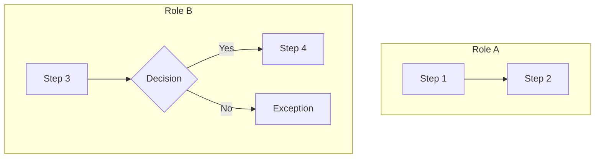

# Phase 1.6 — Business Process Analysis

Detailed process derivation and structured output logic for Phase 1.6. The main SKILL.md describes the high-level flow; this reference contains step-level methodology, output formats, QA checks, and ledger rules.

## Trigger & Input

**Trigger**: Phase 1.5 completed (all scenarios confirmed).
**Tier**: All.
**Nature**: Analysis + user confirmation loop until confirmed.

**Input**:
- `requirement/vN/business-analysis.md` — confirmed scenarios with IDs (✅ SC-xxx)
- `requirement/ledger.md` — archived process records from prior versions

## Step 0: Elicit User's L1–L3 Hierarchy (v0.43.0+)

> **核心原则**：L1–L3 是组织级知识（流程分类、流程分组、业务流程），用户通常已有清晰的规划。AI 的价值集中在 L4 子流程的细化上（活动拆解、步骤说明、异常处理）。不要自行猜测 L1–L3。

**Blocking question** — 在推导任何流程之前，先询问用户：

> "你们通常如何组织业务流程？请按以下层级告诉我：
> - **L1 流程分类**（如：核心业务、支撑管理、战略决策）
> - **L2 流程分组**（如：采购管理、销售管理、人力资源）
> - **L3 业务流程**（如：采购申请流程、供应商评审流程）"

**如果用户不熟悉 L1–L4 概念**，提供简要说明：

| 层级 | 含义 | 示例 |
|------|------|------|
| L1 流程分类 | 最高层流程域划分 | 核心业务 / 支撑管理 |
| L2 流程分组 | 分类下的业务领域 | 采购管理 / 销售管理 |
| L3 业务流程 | 具体的端到端业务流程 | 采购申请流程 |
| L4 子流程 | 流程内的具体活动段（AI 协助细化） | 需求提报 / 审批 / 下单 |

**确认 L1–L3 框架后才进入 Step 1。** 如果用户说"你来帮我规划"或"我没有现成的分类"，AI 可以基于已确认的业务场景（SC-xxx）推导 L1–L3 建议，但必须经用户确认。

## Step 1: Derive L4 Sub-processes from Scenarios

Based on the user-confirmed L1–L3 framework, derive L4 sub-processes for each L3 process:

For each confirmed scenario, derive a step sequence using BPMN thinking:

- **Roles / swimlanes**: identify all actors (human, system, external)
- **Activities**: discrete work units each actor performs
- **Events**: start event, intermediate events, end event
- **Gateways**: decision points that branch the flow (exclusive / parallel / inclusive)

Map each scenario to the appropriate L3 process (from user's framework), then produce L4 sub-processes under that L3. A scenario may map to one or more L4 sub-processes.

## Step 2: Compare Against Existing Processes

Read both sources:

1. `requirement/ledger.md` — archived processes from prior versions
2. `requirement/vN/business-analysis.md` — processes already documented in the current version

Classify each draft process:

| Outcome | Action |
|---------|--------|
| New process | Create entry with status 🔵 待确认 |
| Optimised process | Create a changed version in current `business-analysis.md` |
| Unchanged | Skip — no entry needed |

## Step 3: Structured Output (Three Forms)

### 3.1 L1–L4 Classification Table

Fill the business process overview table (aligns with PRD §2). **L1–L3 come from the user-confirmed framework (Step 0); L4 is derived by AI (Step 1):**

| L1 Group (用户定义) | L2 Category (用户定义) | L3 Process (用户定义) | L4 Sub-process (AI 细化) | Status | Related Scenarios |
|----------|-------------|------------|----------------|--------|-------------------|

**Hierarchy**: L1 → L2 → L3 → L4. L1–L3 are user-defined organizational structure; L4 is AI-assisted refinement. L3 is a collection of L4 sub-processes. Each ledger record corresponds to one L4. **L4 is the minimum recording unit.**

### 3.2 Process Flow Diagram

Output a mermaid flowchart for each L4 sub-process:

**Rules**: Must use `flowchart TB`; must partition by role swimlanes (`subgraph`); every gateway must label all branches; exception paths must terminate explicitly.

### 3.3 Activity Table (9 Columns — Hard Constraint)

One table per L4 sub-process:

| Step | Activity | Execution Steps | Role | Trigger | Input | Output | Related Function | Exception Handling |
|------|----------|-----------------|------|---------|-------|--------|------------------|--------------------|

**All 9 columns are mandatory.** "Execution Steps" describes the concrete actions within each activity — must not be empty. "Related Function" references FUNC-xxx IDs or is marked "TBD". "Exception Handling" must cover every exception branch visible in the flow diagram.

### 3.4 Process Attribute Block

Each L4 sub-process carries a property header:

| Field | Description |
|-------|-------------|
| Process ID | BP-xxx |
| Status | 🔵 待确认 / ✅ 已确认 |
| L1 / L2 / L3 / L4 | Full classification path |
| Related Scenarios | SC-xxx IDs |
| Trigger Event | What initiates the process |
| End Condition | What terminates the process |
| Involved Roles | All actors |

## Step 4: Reverse Reference Update

After producing the three output forms, update `business-analysis.md`:

- Each scenario's "Related Process" field → list associated BP-xxx IDs
- Each requirement's "Related Process" field → list associated BP-xxx IDs

**Do not update `ledger.md`.** Ledger entries are written in bulk during version archiving, not during analysis.

## Step 4.5: QA-2 Process Quality Check

Dispatch `process-quality-checker` sub-agent. Evaluate 9 checks:

| ID | Category | Check | Severity |
|----|----------|-------|----------|
| C1 | Completeness | Every confirmed scenario (✅ SC-xxx) has ≥1 related process | Error |
| C2 | Completeness | Every process has L1–L4 fully filled (L4 non-empty) | Error |
| C3 | Completeness | Every process has a mermaid flow diagram | Error |
| C4 | Completeness | Activity table has 9 columns and every step has "Execution Steps" filled | Error |
| C5 | Consistency | Process "Related Scenarios" IDs exist in the scenario registry | Error |
| C6 | Consistency | Flow diagram steps correspond 1:1 with activity table steps | Error |
| C7 | Consistency | Reverse references complete — related scenarios' "Related Process" field updated | Warning |
| C8 | Accuracy | Exception handling covers all exception branches in the flow diagram | Warning |
| C9 | Accuracy | "Related Function" IDs are valid (FUNC-xxx exists or marked TBD) | Warning |

**Routing**: All Error checks PASS → proceed to Step 5. Any Error FAIL → return to correct (max 3 rounds). Warnings are reported but do not block.

## Step 5: Layered Display & Confirmation (v0.43.0+)

Use **two-stage confirmation** to reduce correction cost:

**Stage A — L1–L3 Framework Review:**
Present the L1–L4 classification table (3.1) to the user. Focus on confirming the L1–L3 framework is correct:
- ✅ **L1–L3 框架确认** → proceed to Stage B
- ✏️ **L1–L3 需要调整** → apply feedback on L1–L3; re-derive L4 under adjusted framework; re-present Stage A

**Stage B — L4 Detail Review (per L3 process):**
For each L3 process, present its L4 sub-processes with flow diagrams (3.2), activity tables (3.3), and attribute blocks (3.4) as a blocking question:
- ✅ **Confirmed** → upgrade status to ✅ 已确认
- ✏️ **Adjust** → apply feedback; return to Step 3 for this L3; loop until confirmed

After all L3 processes confirmed: write into current version `business-analysis.md`; exit (no ledger update).

## Write Rules

| Target | When | What |
|--------|------|------|
| `business-analysis.md` (current version) | On confirmation | Process details + reverse references |
| `ledger.md` | Never during Phase 1.6 | Bulk-written at version archiving only |

## Deprecation Handling

When a process is deprecated, execute all three steps:

1. Delete the record from `ledger.md`
2. Delete the detail block from the version's `business-analysis.md`
3. Update `doc/active-registry/active-items.md`
