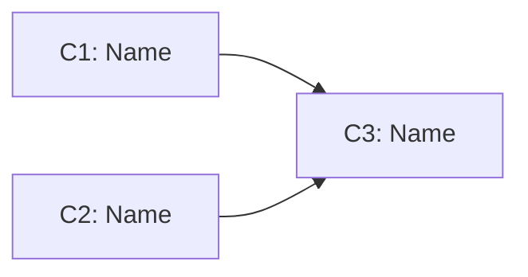

# Change Dependency Graph (v0.5)

## When to Include

For plans with 2+ changes, include a dependency DAG showing:
- Which changes depend on which (by C-ID)
- Which changes can be implemented in parallel
- The critical path (longest dependency chain)

## Rendering Options

Render as a mermaid graph or a simple table.

### Table Format

| change | depends-on | can-parallel-with | priority |
|--------|-----------|-------------------|----------|
| C1     | —         | C2                | P0       |
| C2     | —         | C1                | P0       |
| C3     | C1, C2    | —                 | P1       |

### Mermaid Format

## Critical Path

Identify and label the critical path — the longest dependency chain that determines minimum project duration. Changes not on the critical path have scheduling flexibility.

## Parallelism Guidance

Explicitly call out which changes can be implemented in parallel (no dependency between them). This helps teams and automated workflows maximize throughput.
